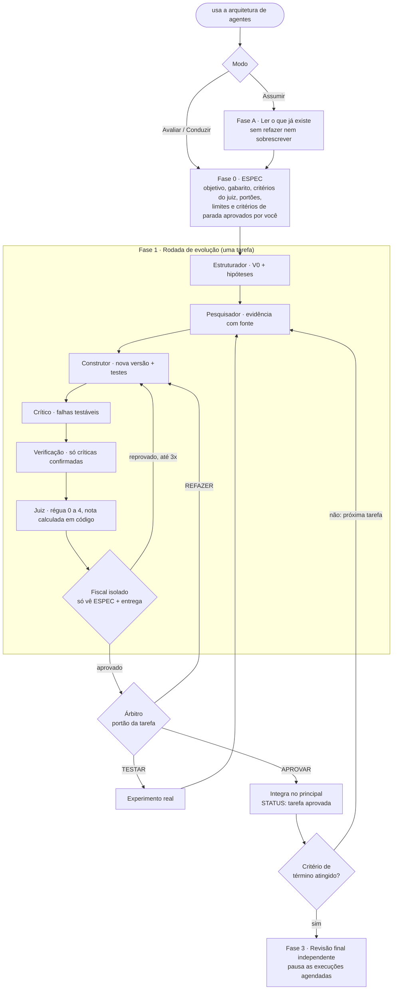
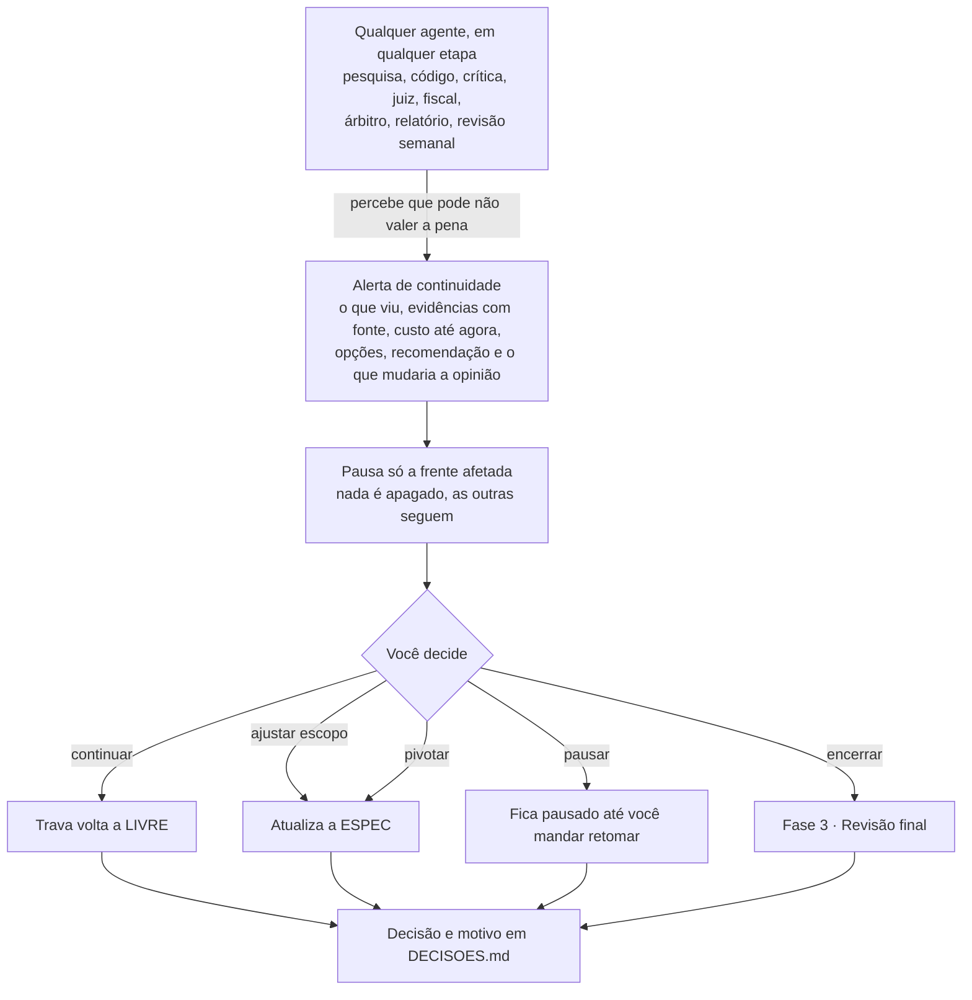
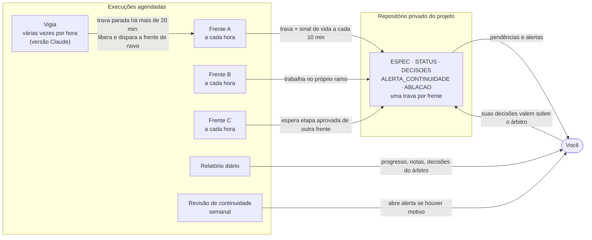

# Agent Architecture Skill

An AI skill that evaluates, evolves and runs any project end to end — a business idea, a research paper, a piece of software — using a team of AI agents with built-in quality control. Versions for **Claude**, **ChatGPT / Codex** and **Grok**, all in the open Agent Skills format (`SKILL.md`).

It combines two systems I built:

- **[Idea Evolution Engine](https://github.com/souzaeliasrafael/idea-evolution-engine)** — agents that turn a raw idea into an auditable decision through bounded rounds of research, building, criticism and scoring.
- **A long-running research pipeline** (a neighborhood-boundary study for a Brazilian city) that runs for days in the cloud on parallel workstreams, with a blind reviewer checking every delivery and an arbiter deciding gates without waiting for me.

The skills are written in Portuguese:

| Platform | File | Parallel runs | Isolated reviewer |
|---|---|---|---|
| Claude | `skills/claude/arquitetura-agentes/SKILL.md` | Scheduled tasks + watchdog that re-fires stalled workstreams | Sub-agent |
| ChatGPT / Codex | `skills/chatgpt/arquitetura-agentes/SKILL.md` | ChatGPT scheduled tasks (research, text, reports) + Codex (code) | Separate run that sees only the spec and the delivery |
| Grok | `skills/grok/arquitetura-agentes/SKILL.md` | Grok Automations, with a model chosen per run | Separate run that sees only the spec and the delivery |

The method is identical across versions; only the execution layer changes. Where a platform cannot trigger one run from another, recovery comes from the lock rule itself: the next scheduled run takes over any lock without a heartbeat for 20 minutes.

## How it works

The flowcharts below are in Portuguese, like the skill itself. Sources (`.mmd`) and PNG versions are in [`docs/`](docs/).

### 1. Evolution round (one task)

### 2. Continuity alert: agents recommend, only the human decides

### 3. Parallel execution

| Role | What it does |
|---|---|
| **Spec** | Written first: goal, ground truth, judging criteria, gates, constraints, stop condition. Everything project-specific lives here, never in the skill. |
| **Researcher** | Picks the highest-impact open hypothesis and looks for sourced evidence. Facts, assumptions and inferences are always labeled. |
| **Builder** | Produces a new version. Previous versions are immutable. |
| **Critic** | Lists testable flaws, each with the condition that would confirm it. |
| **Judge** | Scores each criterion 0–4 on a fixed rubric (no source → max 1). The final 0–100 score is computed in code, not estimated. |
| **Reviewer** | A separate sub-agent that sees only the spec and the delivery, not the reasoning behind it, and checks it item by item. |
| **Arbiter** | Decides gates on its own and writes down the reasoning for the human to review later. Human decisions always override it. |

### Running unattended, in parallel

- **Workstreams** run in parallel, each on its own git branch, coordinated through files in a private repo (`SPEC`, `STATUS`, decisions, sources, ablation table).
- **Lock + heartbeat:** each workstream takes a lock before working and commits a heartbeat every 10 minutes; a stale lock (20 min) can be taken over.
- **Dependencies:** a workstream that needs another one's result releases its lock as "waiting for X" and resumes only when `X: approved` appears in the status file.
- **Watchdog (Claude version):** a small, cheap agent runs several times an hour, frees stale locks and re-fires stalled workstreams.
- **Daily report:** progress, score changes, arbiter decisions to review, items waiting on the human, stagnation detection.

### Rules that never change

- Write down the reason for every decision.
- Never overwrite, move or delete earlier work.
- Ablation: a new feature stays only if it measurably improves the metric in the spec.
- Validate on the full dataset, not just a sample, when cost allows.
- Irreversible actions (deleting data, publishing, spending money, contacting third parties) stop that workstream and wait for the human.
- Nothing invented: every data point and reference needs a verified source.
- Only the human decides whether the project continues. Any agent, at any stage, can raise a **continuity alert** (evidence, cost so far, options, recommendation, and what would change its mind); the affected workstream pauses until the human answers, and nothing is discarded.

## Modes

- **Evaluate** — runs the evaluation rounds in a single conversation.
- **Run** — creates scheduled tasks that develop and monitor the project until the stop condition.
- **Take over** — adopts a project already in progress without redoing or overwriting anything.

## Installation

Pick the folder for your platform and install it as a skill, then say *"usa a arquitetura de agentes"*.

- **Claude app:** upload `skills/claude/arquitetura-agentes` as a skill (zip the folder if asked for a file).
- **Claude Code:** copy that folder to `~/.claude/skills/` (all projects) or to `.claude/skills/` inside a repository (that project only).
- **ChatGPT:** upload `skills/chatgpt/arquitetura-agentes` in the Skills section.
- **Codex:** copy the same ChatGPT folder into your Codex skills folder.
- **Grok:** create a custom skill from `skills/grok/arquitetura-agentes`.

Skill availability depends on each platform's plan and rollout.

## Compatibility note

The evaluation rounds work anywhere. The Claude version names tools that exist only in the Claude app with scheduled tasks (`create_trigger`, `update_trigger`, `fire_trigger`, `list_triggers`, `add_repo`); the ChatGPT and Grok versions use their platforms' own schedulers instead. Anywhere else, use an equivalent scheduler such as cron or GitHub Actions.

## Models

Workstreams, reviewer and report run on a mid-size model to fit usage limits; the arbiter uses a larger model with extended reasoning; the watchdog (Claude version) uses the smallest model; a final independent review uses the most capable model available.

## License

MIT
